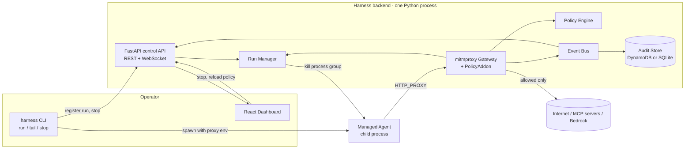
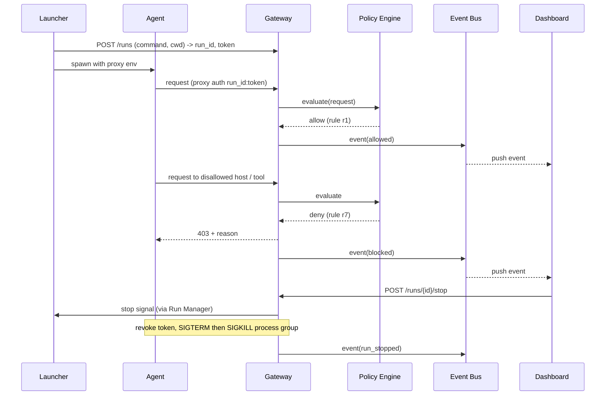

# Design Document

## Overview

Agent Harness is a Python backend plus a React dashboard. A CLI launcher starts an agent as a supervised child process with its network pointed at a local gateway. The gateway is a mitmproxy-based proxy with a policy addon. A FastAPI control API exposes runs, events, policy, and stop controls. The dashboard consumes them over REST and WebSocket.

Key design decisions:
- **mitmproxy as the gateway engine.** It already handles HTTP, CONNECT, and TLS interception with a local CA, so we spend time on policy and UX instead of proxy plumbing.
- **Single backend process** runs the proxy and the FastAPI control API on one asyncio loop, sharing in-memory state (runs, policy, event bus). This keeps stop and revoke effectively instant.
- **Per-run proxy credentials.** The launcher sets `HTTP_PROXY=http://<run_id>:<token>@127.0.0.1:8080`. Revoking the token cuts off the run at the gateway.
- **Process-group termination.** The agent starts in its own session so Stop can kill the whole tree.
- **Pluggable storage.** DynamoDB when AWS is configured, SQLite otherwise.

## Architecture



### Request flow (the demo path)



## Components and Interfaces

### Repository layout

```
agent-harness/
  backend/
    harness/
      cli.py            # Typer CLI: run, tail, stop, policy
      launcher.py       # spawn child, env setup, process group
      gateway.py        # mitmproxy addon (auth, policy, events)
      policy.py         # rule model + evaluation
      mcp.py            # MCP / JSON-RPC tool call parsing
      runs.py           # RunManager: registry, tokens, stop
      events.py         # EventBus (asyncio pub/sub)
      redact.py         # secret redaction
      api.py            # FastAPI app (REST + WebSocket)
      store/
        base.py         # AuditStore interface
        sqlite.py
        dynamodb.py
      main.py           # starts proxy + API together
    policies/demo.yaml
    demo/demo_agent.py
    tests/
  dashboard/            # React + Vite + TypeScript
  README.md
```

### Launcher (`launcher.py`, `cli.py`)

- `harness run [--policy file] -- <cmd...>`
  1. Check the backend health endpoint. Fail with an actionable message if unreachable (Req 1.5).
  2. `POST /runs` to get `run_id` and `token`.
  3. Build env: `HTTP_PROXY`, `HTTPS_PROXY`, `ALL_PROXY` (lowercase variants too), `NO_PROXY` (empty except the control API host exclusion handling), `SSL_CERT_FILE`, `REQUESTS_CA_BUNDLE`, `NODE_EXTRA_CA_CERTS`, `AWS_CA_BUNDLE`, all pointing to the mitmproxy CA. Also `HARNESS_RUN_ID`.
  4. `subprocess.Popen(cmd, env=env, start_new_session=True)`, stream stdout and stderr through to the terminal.
  5. On exit, `POST /runs/{id}/finish` with the exit code.
  6. On Ctrl+C, forward the signal, then request stop.
- `harness tail <run-id>`: connects to the WebSocket and prints colored events.
- `harness stop <run-id>`: calls the stop endpoint with the operator token.

### Gateway (`gateway.py`)

A mitmproxy addon with these hooks:

- `http_connect` and `requestheaders`: parse `Proxy-Authorization`, resolve the run, reject with 407 if missing or invalid or revoked (Req 2.2, 2.3, 5.2).
- `request`: build a `RequestContext` (run_id, method, host, path, headers, body preview). Run the MCP parser (Req 2.5). Call `PolicyEngine.evaluate`. If deny, set `flow.response` to a 403 JSON body `{blocked: true, rule, reason}` (Req 4.4). If the rule has `terminate_on_violation`, call `RunManager.stop` (Req 5.4). Publish an event either way.
- `response`: attach status code and size to the matching event, and publish an update.
- Requests addressed to the control API host or port from a Managed_Agent are denied (Req 9.4).

### Policy Engine (`policy.py`)

Policy file (YAML):

```yaml
default: deny
rate_limit: { requests_per_minute: 120 }
rules:
  - id: allow-bedrock
    action: allow
    host: "bedrock-runtime.*.amazonaws.com"
  - id: allow-github-read
    action: allow
    host: "api.github.com"
    methods: [GET]
  - id: block-exfil
    action: deny
    host: "*.pastebin.com"
    terminate_on_violation: true
  - id: block-delete-tool
    action: deny
    mcp_tool: "delete_*"
```

Evaluation order:
1. Check the rate limit per run (sliding window). Over limit means deny with reason `rate_limit`.
2. Collect every matching rule. Any deny match wins (deny precedence, Req 4.2).
3. Else an allow match wins.
4. Else apply `default` (Req 4.3).

Matching uses `fnmatch` on host, path, and `mcp_tool`, plus an optional method list. The result is `Decision(action, rule_id, reason, terminate)`. The engine holds the active policy behind a lock and swaps it atomically on reload (Req 4.5, 4.6). Reload is triggered by a file watcher or `POST /policy/reload`. Invalid files are rejected and the previous policy stays active.

### MCP parser (`mcp.py`)

If the body is JSON with `jsonrpc: "2.0"` and `method == "tools/call"`, extract `params.name` and `params.arguments`. For batch arrays, evaluate each call and deny the request if any is denied. Non-JSON or oversized bodies are skipped (host/path rules still apply).

### Run Manager (`runs.py`)

```python
@dataclass
class Run:
    id: str
    command: list[str]
    cwd: str
    token_hash: str
    status: Literal["running", "stopped", "finished"]
    pid: int | None
    started_at: datetime
    ended_at: datetime | None
    exit_code: int | None
    counts: dict  # allowed, blocked
```

- Tokens are random 32 bytes, stored only as a SHA-256 hash, compared in constant time.
- `stop(run_id, actor, reason)`: mark status `stopped`, revoke the token, `killpg(SIGTERM)`, wait up to 2 seconds, `killpg(SIGKILL)`, publish `run_stopped`. This meets the 3 second target (Req 5.5).
- Because the launcher owns the child, the backend learns the pid at registration and kills the group directly (the harness runs on the same machine for the demo). A fallback sends a stop message over the launcher's WebSocket so the launcher kills the process if the backend is remote.

### Event Bus and Store

Event model:

```python
class Event(BaseModel):
    id: str
    run_id: str
    ts: datetime
    kind: Literal["request", "run_started", "run_stopped", "run_finished", "policy_reloaded"]
    method: str | None
    host: str | None
    path: str | None
    tool: str | None
    decision: Literal["allowed", "blocked"] | None
    rule_id: str | None
    reason: str | None
    status_code: int | None
    headers: dict   # redacted
```

- `EventBus`: asyncio pub/sub with per-subscriber bounded queues (drop oldest on overflow so a slow UI never blocks the proxy).
- `redact.py` runs before publish and persist: masks `Authorization`, `Proxy-Authorization`, `Cookie`, `x-api-key`, and values matching common token patterns (Req 6.3, 9.3).
- `AuditStore` interface: `put_event`, `list_events(run_id, since, until, limit)`, `put_run`, `list_runs`. SQLite is the default. DynamoDB uses a table with partition key `run_id` and sort key `ts#event_id` (Req 6.2, 6.4).

### Control API (`api.py`)

All routes except `/health` require `Authorization: Bearer <operator token>`, generated at backend start and printed once (Req 9.1). The API binds to 127.0.0.1 by default (Req 9.2).

| Method | Path | Purpose |
|---|---|---|
| GET | /health | liveness |
| POST | /runs | register run, returns run_id and proxy token |
| POST | /runs/{id}/finish | launcher reports exit |
| GET | /runs | list runs with counts |
| GET | /runs/{id}/events | query events |
| POST | /runs/{id}/stop | kill switch |
| GET | /policy | active policy and version |
| POST | /policy/reload | reload from file |
| PUT | /policy | replace policy (validated) |
| WS | /ws?run_id= | live event stream |

### Dashboard (React + Vite + TypeScript)

- **Runs sidebar:** status badge, command, allowed/blocked counters, Stop button.
- **Live traffic table:** virtualized list, color-coded rows (green allowed, red blocked, grey pending), filter by decision, auto-scroll toggle.
- **Event detail drawer:** redacted headers, matched rule, reason.
- **Policy panel:** rules list; the rule that blocked the selected event is highlighted (Req 7.3). Reload button.
- **State:** a `useEventStream` hook wrapping the WebSocket with auto-reconnect; initial data from REST. No manual refresh needed (Req 7.4).
- **Accessibility:** semantic table, focusable controls, ARIA labels, status conveyed by text and icon in addition to color (Req 7.5).

## Data Models

Covered above: `Run`, `Event`, `Policy` (YAML rules, `Decision`). Rule schema is validated with Pydantic.

## AWS Usage

- **Amazon Bedrock:** the demo agent calls a Bedrock model, so the gateway visibly governs real model traffic (allowed host rule for `bedrock-runtime.*.amazonaws.com`). The demo can also show a Bedrock request to a non-approved region being blocked.
- **DynamoDB:** audit store.
- **CloudWatch:** optional metrics (allowed/blocked counts, stops) emitted via `boto3`.
- **Stretch:** deploy the backend on ECS Fargate or EC2 behind an NLB for the "scalable design" story; Verified Permissions (Cedar) as an alternative policy backend behind the same `PolicyEngine` interface.

## Bedrock Integration Details

Based on the SCU ACM Bedrock guide (https://github.com/SCUACM/aws-access-26/tree/main/2-bedrock):

- **Client setup:** `boto3.client("bedrock-runtime", region_name="us-east-1", ...)` with credentials read from `AWS_ACCESS_KEY_ID`, `AWS_SECRET_ACCESS_KEY`, `AWS_SESSION_TOKEN` in the environment. Never hardcode credentials, and call AWS from the backend only.
- **Demo agent API:** use `client.converse(...)` for a simple reply and `client.converse_stream(...)` for streaming, as in the guide's `bedrock.py` and `converse.py`.
- **Model ID:** default `us.meta.llama4-scout-17b-instruct-v1:0` (an inference profile ID, note the `us.` prefix). Configurable via `BEDROCK_MODEL_ID`. A `ValidationException` saying "Retry your request with the ID or ARN of an inference profile" means the plain model ID was used.
- **Through the proxy:** the launcher passes the parent's `AWS_*` variables to the child unchanged and adds `HTTPS_PROXY` and `AWS_CA_BUNDLE` (the mitmproxy CA). The Bedrock endpoint seen by the gateway is `bedrock-runtime.us-east-1.amazonaws.com`, matched by the `bedrock-runtime.*.amazonaws.com` allow rule. The request path (`/model/<modelId>/converse` or `/converse-stream`) is available to policy, so rules can allow only approved models.
- **Streaming:** `converse_stream` returns a long-lived event stream. The gateway enables response streaming for Bedrock hosts (`flow.response.stream = True`) so tokens are not buffered.
- **Extra redaction:** SigV4 requests carry `Authorization`, `X-Amz-Security-Token`, and `X-Amz-Date`/`X-Amz-Content-Sha256` headers. `redact.py` must mask `X-Amz-Security-Token` and the SigV4 signature in `Authorization`.
- **Demo moment:** a policy rule allows only one model path (for example the Llama 4 Scout profile). The agent then tries a different Bedrock model, and the gateway blocks it with a 403. The agent's boto3 call raises a visible error, which makes a clear demo.
- **Credential note:** Workshop Studio session credentials expire. If the demo shows `ExpiredTokenException` or `UnrecognizedClientException`, rerun the credential script from the guide's 1-setup step and reopen the terminal.

## Error Handling

| Case | Behavior |
|---|---|
| Backend down at launch | Launcher exits non-zero with instructions (Req 1.5) |
| Missing or revoked proxy credential | 407, event logged |
| Invalid policy file | Reload rejected, previous policy kept, error shown in UI |
| Upstream failure | 502 returned to agent, event marked with error |
| Store failure | Events still delivered live; store errors logged and retried in a background queue |
| Slow dashboard | Bounded queue drops oldest events for that subscriber only |
| Agent ignores proxy settings | Documented limitation; mitigation is env injection plus optional macOS/Linux firewall rules as future work (Req 9.5) |

## Testing Strategy

- **Unit:** policy evaluation (precedence, default, rate limit, wildcard matching), MCP parser, redaction, token hashing.
- **Integration:** start the backend in-process, run a stub agent through the proxy against a local upstream server, and assert allow, block, 403 body, event emission, and stop within 3 seconds.
- **Demo rehearsal script:** `make demo` runs the full flow and asserts the expected final state.
- **Dashboard:** component tests for the event table and stop button (Vitest + Testing Library); manual accessibility pass with keyboard only.
- Property-style tests are valuable for the policy engine (deny always beats allow regardless of rule order).

## Demo Plan (under 3 minutes)

1. Start the backend and open the dashboard.
2. `harness run -- python demo/demo_agent.py`. The agent calls Bedrock and GitHub (allowed).
3. Traffic streams in the dashboard and `harness tail`.
4. The agent attempts a disallowed action (for example posting to a paste site or calling `delete_repo`). It shows red with the matching rule and the agent receives a 403.
5. Click Stop. The process dies, the run shows `stopped`, and further requests with the old token are rejected.
