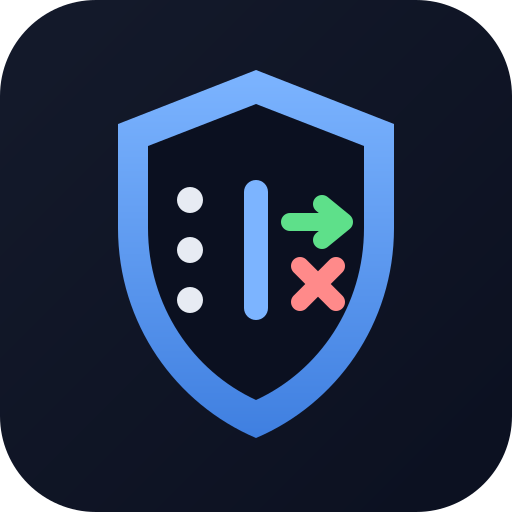
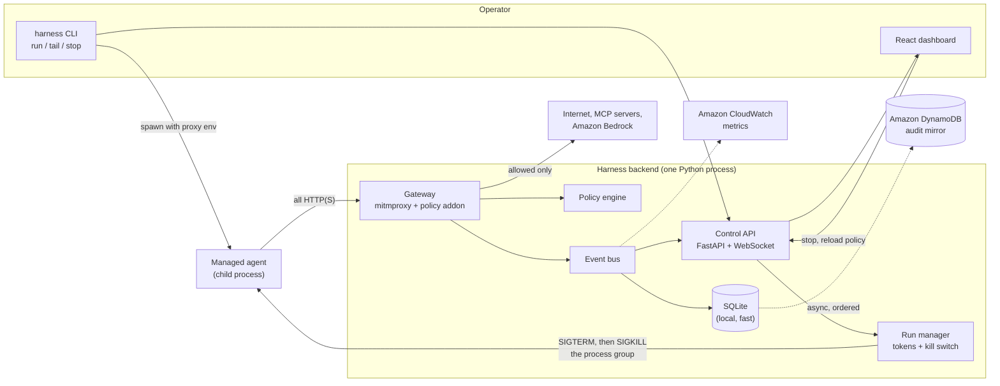

<p align="center"></p>

# Agent Harness

**A control layer for CLI and desktop AI agents.** Every request an agent makes goes through one gateway that shows it live, applies policy, blocks what is not allowed, and can stop the agent instantly.

Built for the AWS x A10 Hack 2026, Track 2: *Agent Harness: Secure and Manage Agent Activity.*

> Demo: launch a CLI agent, watch its traffic, see a disallowed action blocked, and stop the run.

---

## Why

Coding agents (Kiro CLI, Claude Code, Copilot CLI, homegrown scripts) run with a developer's credentials and full network access. Security teams can't see what they call, can't stop an agent mid-task, and have no audit trail. Agent Harness gives them:

| Problem | What the harness does |
|---|---|
| "What is this agent talking to?" | Every request is captured and streamed live (CLI and dashboard). |
| Data exfiltration, unapproved services | Default-deny policy on host, path, method, and MCP tool name. |
| Expensive or unapproved models | Allow-list Bedrock models by path; any other model is blocked before it reaches AWS. |
| A run going wrong | A kill switch revokes the run's credentials and terminates its whole process tree in under 3 seconds. Rules can trigger it automatically. |
| Compliance and incident review | Durable audit log in DynamoDB with credentials redacted; metrics in CloudWatch. |

## How it works



1. `harness run -- <agent>` registers a run and gets a one-time proxy credential. It starts the agent in its own process group with `HTTP(S)_PROXY` pointing at the gateway and every common CA variable pointing at the gateway's CA: Python, requests, curl, Node, boto3 and git. The operator token is never passed to the agent.
2. The **gateway** (a mitmproxy addon) authenticates each connection to its run and parses MCP `tools/call` bodies. It evaluates the policy, then either forwards the request or returns a `403` with the rule and reason. Upstream connections are lazy, so a blocked host is never contacted, not even a TCP handshake. Bedrock token streams pass through unbuffered.
3. Every decision becomes an **event**. Events stream to the CLI and the dashboard, go into local SQLite, and are mirrored to **DynamoDB** and counted in **CloudWatch**. Credentials (SigV4 signatures, AWS session tokens, bearer tokens, API keys, cookies) are redacted before anything is stored or shown.
4. **Stop** (button, CLI, or a `terminate_on_violation` rule) revokes the run's credential first. Requests on an already-open tunnel are refused at once. Then it kills the process tree.

## Quick start

Requirements: macOS or Linux, Python 3.11+, Node 22 or 24 (Node 25 works but npm prints engine warnings).

```bash
make setup                     # venv, backend deps, `harness` CLI, dashboard deps
make test                      # backend (pytest) + dashboard (vitest)
```

Three terminals, all from the repo root:

```bash
make serve                     # 1. gateway :8080 + control API :8000 (prints the operator token)
make dashboard                 # 2. http://localhost:5173, paste the operator token
make demo                      # 3. the demo agent, run under the harness
```

For the Bedrock steps, terminal 3 needs AWS credentials. Use the hackathon's Workshop Studio session keys (`export AWS_ACCESS_KEY_ID=… AWS_SECRET_ACCESS_KEY=… AWS_SESSION_TOKEN=…`), with model access enabled for Llama 4 Scout in `us-east-1`.

No browser? `./venv/bin/harness tail` shows the same live stream in a terminal.

### Self-check

```bash
make checkpoint                # runs the whole demo on private ports and verifies every step
```

It runs its own backend, so it can run alongside `make serve`. It auto-detects AWS credentials, prints PASS, WARN or FAIL per step, and exits non-zero on failure.

## Demo script (about 3 minutes)

| | Say | Do / show |
|---|---|---|
| 1 | "Agents run with our credentials and full network access. Here is one under the harness." | `make demo`. The run appears in the dashboard sidebar. |
| 2 | "Every request goes through one gateway." | Dashboard: the Bedrock call (Llama 4 Scout) is **Allowed**, and the answer streams token by token in the terminal. GitHub read is **Allowed**. |
| 3 | "Only approved models." | The Titan request is **Blocked** by the default deny. Click it: the policy panel highlights *Everything else (default)*. The agent got a 403 and AWS was never called. |
| 4 | "It tries to exfiltrate data." | The pastebin POST is **Blocked** by `block-paste-sites`. That rule has `terminate_on_violation`, so the run shows **Stopped** and the agent process is gone. |
| 5 | "Or stop it yourself." | Start another `make demo`, then click **■ Stop**. The credential is revoked and the process tree killed. |
| 6 | "And it's all audited." | Open the request details: SigV4 `Authorization` and `X-Amz-Security-Token` are `[REDACTED]`. Show the DynamoDB table items and the CloudWatch `AgentHarness` metrics. |

## AWS services

| Service | Use |
|---|---|
| **Amazon Bedrock** | The demo agent's model (Llama 4 Scout via `converse_stream`). The policy allow-lists one model by request path. Any other model is blocked at the gateway. |
| **Amazon DynamoDB** | Durable, central audit log. Single-table design: `pk=RUN#<id>`, with `sk=META` for the run and `sk=EVT#<ts>#<id>` for events, so a time-range query is one Query. A GSI lists runs newest-first, and TTL handles retention. Writes are mirrored asynchronously, in order, with retries, so an AWS outage never slows enforcement. |
| **Amazon CloudWatch** | Metrics: `Requests` by `Decision`, `AuthFailures`, `RunsStarted`, `RunsStopped`, `RunsFinished`, `PolicyTerminations`. Aggregated in memory, so it's one API call per interval. |
| **AWS STS / IAM** | Uses temporary Workshop Studio session credentials only. No long-lived keys. |

Enable the AWS features (needs credentials in the `serve` terminal):

```bash
./venv/bin/harness aws-setup --table agent-harness-audit     # once: creates the table (on-demand) + TTL
./venv/bin/harness serve --dynamodb-table agent-harness-audit --cloudwatch-namespace AgentHarness
# or: make aws-setup && make serve-aws
```

Without these flags nothing touches AWS, and the harness uses local SQLite only.

## Policy

`backend/policies/demo.yaml`. The file is hot-reloaded on save. An invalid edit is rejected and the previous policy stays active.

```yaml
default: deny                          # anything not explicitly allowed is blocked
rate_limit: { requests_per_minute: 120 }   # per run
rules:
  - id: allow-bedrock-approved-model
    action: allow
    host: "bedrock-runtime.*.amazonaws.com"
    path: "/model/us.meta.llama4-scout-17b-instruct-v1:0/*"
  - id: allow-github-read
    action: allow
    host: "api.github.com"
    methods: [GET]
  - id: block-paste-sites
    action: deny
    host: "*pastebin.com"
    terminate_on_violation: true       # also stops the run
  - id: block-destructive-tools
    action: deny
    mcp_tool: "delete_*"               # matched inside JSON-RPC tools/call bodies
```

Rules match on `host`, `path`, `methods` and `mcp_tool` (glob patterns, and every field set must match). **Deny always beats allow**, whatever the rule order. Paths are percent-decoded before matching, because boto3 encodes the `:` in model IDs.

## CLI

```
harness serve       start the gateway and control API
harness run -- …    run an agent under the harness (exit code passes through; 143 = stopped)
harness tail [run]  live ALLOW / BLOCK stream; exits when the run ends
harness stop <run>  kill switch
harness runs        runs with status and allowed/blocked counts
harness aws-setup   create the DynamoDB audit table
```

## Security model and known limits

What is enforced:
- **Each run gets its own credential.** Only a SHA-256 hash is kept, and it's compared in constant time. It's revoked on stop or exit, and checked on every request inside an open tunnel.
- **The control API requires an operator token** and binds to `127.0.0.1`. A managed agent cannot reach the control API or the proxy itself through the gateway. Browser access is limited to the dashboard's origin (CORS).
- **Fail closed.** If the launcher can't register the agent's pid, it kills the agent. Shutting down the harness stops every managed agent.
- **No upstream contact for blocked requests.** Credentials never leave the gateway in logs, the dashboard, or DynamoDB.

Known limits (the next things to build):
- **An agent that ignores proxy settings** (raw sockets, its own HTTP stack) bypasses the gateway. Fix: OS-level enforcement (macOS Network Extension, Linux network namespaces or nftables) that only allows egress to the gateway.
- **The operator token file** (`~/.agent-harness/operator_token`, mode 600) is readable by an agent running as the same OS user. Fix: run agents as a separate user, or keep the token in the Keychain.
- **Certificate-pinning clients** refuse the gateway CA. The harness logs this as a blocked TLS failure. **UDP/QUIC (HTTP/3)** is not proxied.
- **MCP bodies over 1 MB** are not parsed. Host and path rules still apply.
- **Agents that read `/dev/tty` directly** can behave oddly, because the agent runs in its own session so the harness can kill the whole tree.
- **Single node.** The DynamoDB mirror and CloudWatch metrics already make the audit trail central. A fleet version would put the gateway on each developer machine, or as a shared egress proxy, with policy distributed from a central service.

## Who would buy this

Engineering organizations rolling out AI coding agents, whose security and compliance teams need to say yes to agents without giving up visibility. It installs per developer with no agent changes: `harness run -- <your agent>`. Revenue would come from per-seat pricing for the managed version, with central policy, a fleet dashboard, SSO and SIEM export. The audit trail maps to SOC 2 and ISO 27001 evidence requirements.

## Testing

- **Backend: 172 pytest tests.** They cover:
  - policy precedence and rate limits, redaction and MCP parsing
  - a real mitmproxy with HTTP/HTTPS stub upstreams: auth, block, kill switch on open tunnels, lazy upstream connections, unbuffered streams
  - killing a real process tree within 3 seconds
  - the API over real uvicorn and WebSockets
  - the CLI as subprocesses, end to end
  - DynamoDB and CloudWatch against `moto`, so no real AWS
- **Dashboard: 28 vitest and Testing Library tests** (event merging, traffic table, Stop button, policy highlighting).
- `make checkpoint` runs the live demo flow and asserts every step.

## Repository layout

```
backend/
  harness/         gateway.py, policy.py, runs.py, api.py, launcher.py, cli.py, main.py,
                   events.py, redact.py, mcp.py, metrics.py, watcher.py, store/ (sqlite, dynamodb, mirror)
  policies/        demo.yaml
  demo/            demo_agent.py (Bedrock + GitHub + exfiltration attempt), checkpoint.py
  tests/
dashboard/         React + Vite + TypeScript (src/components, eventStore.ts, useEventStream.ts)
assets/logo.svg
.kiro/specs/agent-harness/   requirements, design, and task plan
```
